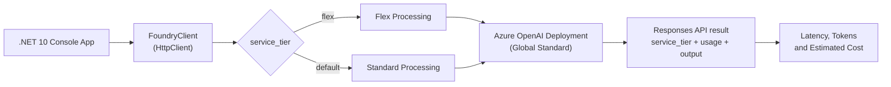

# Microsoft Foundry Flex Processing with .NET 10

A small, educational .NET 10 console application that sends **the same prompt to the same Azure OpenAI deployment** twice:

- once with `service_tier: "flex"` (Flex processing, preview)
- once with `service_tier: "default"` (Standard processing)

It then compares the **processed tier, latency, token usage, and estimated cost** of each request, and shows how to add an **optional Standard fallback** when Flex capacity isn't available.

The main lesson is that Flex needs one request parameter. You don't need a new deployment, a new endpoint, or a different SDK.

> [!NOTE]
> This is a learning sample, not a production system. It uses raw `HttpClient` and `System.Text.Json` so you can see every byte sent to and received from the Responses API.

## Table of contents

1. [Overview](#1-overview)
2. [Flex vs Standard](#2-flex-vs-standard)
3. [Architecture](#3-architecture)
4. [Prerequisites and model support](#4-prerequisites-and-model-support)
5. [Azure setup](#5-azure-setup)
6. [Configuration](#6-configuration)
7. [Running the demo](#7-running-the-demo)
8. [Code walkthrough](#8-code-walkthrough)
9. [Comparing results: tokens and cost](#9-comparing-results-tokens-and-cost)
10. [Error handling and fallback](#10-error-handling-and-fallback)
11. [Security notes](#11-security-notes)
12. [Key takeaways](#12-key-takeaways)
13. [References](#13-references)

---

## 1. Overview

**Flex processing (preview)** is a request-level processing option of Azure OpenAI in Microsoft Foundry Models. According to Microsoft, it offers inference at a **50% discount compared with Standard processing**. In exchange, workloads must tolerate **slower, variable response times and occasional resource unavailability**.

You choose it for each request by setting `service_tier` to `flex` in a Responses API (or Chat Completions API) call. The deployment stays the same.

This repository demonstrates four things:

| # | What | Where |
| - | ---- | ----- |
| 1 | Calling a model with `service_tier: "flex"` | Menu option **1** |
| 2 | Calling the same model with `service_tier: "default"` | Menu option **2** |
| 3 | Comparing latency, tokens, and estimated cost | Menu option **3** |
| 4 | Falling back from Flex to Standard after HTTP 429 (optional) | Menu option **4** |

The demo scenario is an **AI text summarizer**. A fixed technical document of about 2,300 words, about building cloud-native AI applications on Azure, is turned into a long structured report of about 2,000 to 2,500 words. The workload is deliberately large: thousands of input and output tokens make the latency and cost differences between tiers easier to see than a tiny prompt would. Every request uses the same prompt, so differences between runs come from the service, not from the input.

## 2. Flex vs Standard

| | **Flex processing** | **Standard processing** |
| --- | --- | --- |
| How to select | `service_tier: "flex"` on the request | `service_tier: "default"` (or omit it) |
| Deployment | Same Global Standard deployment | Same Global Standard deployment |
| Price | 50% of Standard input and output token rates (cached-token discounts also apply) | Standard pay-per-token rate |
| Latency | Variable, can be much longer; **no latency SLA or service SLA** | Best-effort online processing |
| Capacity | Not guaranteed. Can return **HTTP 429** when Flex capacity isn't available | Subject to deployment quota |
| Quota | **Shared** with Standard (the deployment's quota) | Shared with Flex |
| Fallback | **None automatic.** Your app must retry with `default` | n/a |
| Output quality | Same underlying model | Same underlying model |
| API style | Synchronous (this isn't the Batch API) | Synchronous |

**Good fits for Flex:** model evaluations, data enrichment, document analysis, offline or background jobs, and asynchronous workflows.

**Poor fits for Flex:** interactive chat where a user is waiting, strict latency targets, apps that can't retry HTTP 429, and workloads that need reserved capacity.

Other options exist for those cases: **Priority processing** (lower, more consistent latency), **Batch** (24-hour asynchronous jobs), and **provisioned throughput** (reserved capacity).

> [!IMPORTANT]
> Flex processing is in **preview**. A request with `service_tier: "flex"` is processed only when the selected model supports Flex. For an unsupported model, the service returns **HTTP 400 `invalid_request_error`** and does **not** fall back to Standard.

## 3. Architecture



Repository layout:

```text
MsftFoundryFlexProcessing/
├── src/
│   └── FlexProcessingDemo/
│       ├── Program.cs              # Menu, prompt, comparison report, env-var settings
│       ├── FoundryClient.cs        # Responses API call, parsing, fallback, error type
│       ├── ProcessingResult.cs     # Metrics of one request
│       ├── CostCalculator.cs       # Cache-aware cost estimation
│       ├── prompt.txt              # The fixed prompt sent in every request
│       └── FlexProcessingDemo.csproj
├── .env.example                    # Reference list of environment variables
├── .gitignore
├── README.md
└── MsftFoundryFlexProcessing.slnx
```

The console app has **no NuGet dependencies**.

## 4. Prerequisites and model support

- [.NET 10 SDK](https://dotnet.microsoft.com/download/dotnet/10.0). Check with `dotnet --version`.
- An Azure subscription.
- An **Azure OpenAI resource** (or a Microsoft Foundry resource) with a model deployed using the **Global Standard** deployment type.
- The resource **endpoint** and an **API key**.
- A model **that supports Flex processing** if you want Flex requests to succeed.

### Supported models (check before you run)

At the time of writing (October 2026), the [Flex processing documentation](https://learn.microsoft.com/en-us/azure/foundry/openai/how-to/flex-processing#review-supported-models) lists these models:

| Model | Version | Deployment type |
| --- | --- | --- |
| `gpt-5.6-sol` | `2026-07-09` | Global Standard |
| `gpt-5.6-luna` | `2026-07-09` | Global Standard |
| `gpt-5.6-terra` | `2026-07-09` | Global Standard |
| `gpt-6-astra` | `2026-09-03` | Global Standard |

Microsoft adds models over time, so treat the documentation as the source of truth. Don't assume that a model, or a new version of a supported model, supports Flex just because it supports Standard or Priority processing.

### About GPT-5.6 Luna (the reference model in this sample)

This sample uses **GPT-5.6 Luna** (`gpt-5.6-luna`) as its example model and pricing reference. It is in the Flex supported-model list and supports the Responses API, so both `flex` and `default` requests to the same Global Standard deployment are expected to work.

The **model version matters**. The Flex documentation lists `gpt-5.6-luna` version `2026-07-09`, and a version that isn't listed may not support Flex. When you create the deployment, check the version shown in the portal against the supported-model table.

You can use any other supported model. The code doesn't change, because the model is selected only by the deployment name. Set the price variables to that model's rates (see [Configuration](#6-configuration)).

If you deploy a model that **doesn't** support Flex, Flex requests return **HTTP 400 `invalid_request_error`**. The app reports this as a failed Flex request. It never treats the call as a Flex success and never switches to Standard silently.

## 5. Azure setup

### Option A: Microsoft Foundry portal

1. **Open the portal.** Sign in to [Microsoft Foundry](https://ai.azure.com).
2. **Create or select a resource.** Create a Foundry project or select an existing one backed by an Azure OpenAI / Foundry resource. Choose a region where Global Standard deployments are available.
3. **Pick a model.** Open the model catalog and select a model. For a guaranteed Flex run, pick one from the [supported-model table](#supported-models-check-before-you-run), for example `gpt-5.6-luna` (the model used in this sample).
4. **Deploy it as Global Standard.** Select **Deploy**, choose the **Global Standard** deployment type, and give the deployment a name, for example `flex-demo`. **This name is the value of `AZURE_OPENAI_DEPLOYMENT`.** You don't need a separate "Flex deployment": Flex and Standard requests go to this same deployment.
5. **Copy the endpoint and key.** On the resource overview page (or **Keys and Endpoint** in the Azure portal), copy:
   - the endpoint, for example `https://<RESOURCE_NAME>.openai.azure.com`
   - one of the API keys
6. **Configure the environment variables** as described in [Configuration](#6-configuration).
7. **Run the app** and compare Flex with Standard (see [Running the demo](#7-running-the-demo)).

### Option B: Azure CLI

If you prefer the command line, the following commands create the same setup. Replace every `<...>` placeholder.

```bash
az login

az group create \
  --name <RESOURCE_GROUP> \
  --location <REGION>

az cognitiveservices account create \
  --name <RESOURCE_NAME> \
  --resource-group <RESOURCE_GROUP> \
  --location <REGION> \
  --kind OpenAI \
  --sku S0 \
  --custom-domain <RESOURCE_NAME>

# Use a model/version from the Flex supported-model table for a guaranteed Flex run.
az cognitiveservices account deployment create \
  --name <RESOURCE_NAME> \
  --resource-group <RESOURCE_GROUP> \
  --deployment-name <YOUR_DEPLOYMENT_NAME> \
  --model-name gpt-5.6-luna \
  --model-version 2026-07-09 \
  --model-format OpenAI \
  --sku-name GlobalStandard \
  --sku-capacity 10

# Endpoint
az cognitiveservices account show \
  --name <RESOURCE_NAME> \
  --resource-group <RESOURCE_GROUP> \
  --query properties.endpoint -o tsv

# API key
az cognitiveservices account keys list \
  --name <RESOURCE_NAME> \
  --resource-group <RESOURCE_GROUP> \
  --query key1 -o tsv
```

> [!TIP]
> Model versions change. If the deployment command rejects the version, check the versions available in your region in the portal's model catalog.

## 6. Configuration

The app reads its configuration **only from environment variables**. Nothing is hard-coded, and no secret lives in the repository.

### Required variables

| Variable | Example | Description |
| --- | --- | --- |
| `AZURE_OPENAI_ENDPOINT` | `https://<RESOURCE_NAME>.openai.azure.com` | Resource endpoint. A trailing `/` or `/openai/v1` is accepted and removed. |
| `AZURE_OPENAI_API_KEY` | `<YOUR_API_KEY>` | API key of the resource. |
| `AZURE_OPENAI_DEPLOYMENT` | `<YOUR_DEPLOYMENT_NAME>` | Deployment name, sent as `model` in the request. |

### Optional variables

| Variable | Default | Description |
| --- | --- | --- |
| `FLEX_FALLBACK_ENABLED` | `false` | When `true`, menu option 4 retries with Standard after a Flex HTTP 429. |
| `REQUEST_TIMEOUT_SECONDS` | `900` | `HttpClient` timeout. Flex can be slow, and the Flex docs suggest starting around 15 minutes. |
| `STANDARD_INPUT_PRICE_PER_MILLION` | `0.20` | Standard input price, USD per 1M tokens. |
| `STANDARD_CACHED_INPUT_PRICE_PER_MILLION` | `0.02` | Standard cached-input price, USD per 1M tokens. |
| `STANDARD_OUTPUT_PRICE_PER_MILLION` | `1.20` | Standard output price, USD per 1M tokens. |
| `FLEX_INPUT_PRICE_PER_MILLION` | `0.10` | Flex input price, USD per 1M tokens. |
| `FLEX_CACHED_INPUT_PRICE_PER_MILLION` | `0.01` | Flex cached-input price, USD per 1M tokens. |
| `FLEX_OUTPUT_PRICE_PER_MILLION` | `0.60` | Flex output price, USD per 1M tokens. |

The default prices are the **GPT-5.6 Luna** Global Standard prices for short context (up to 272K input tokens):

| Token type | Standard (USD / 1M) | Flex (USD / 1M) |
| --- | --- | --- |
| Input | 0.20 | 0.10 |
| Cached input | 0.02 | 0.01 |
| Cache write | 0.25 | 0.125 |
| Output | 1.20 | 0.60 |
| Discount | — | 50% |

**Cache write** charges aren't included in the app's estimates, because the API's usage data used by this sample doesn't report cache writes separately. The prompt is long enough to be cached, so a request that writes to the cache may cost slightly more than the estimate. Add a cache-write term to `CostCalculator` if you need that precision.

> [!WARNING]
> Prices change and vary by region, context length, and agreement. The estimates are for learning, not billing. Before you rely on any number, check the [official Azure OpenAI pricing page](https://azure.microsoft.com/pricing/details/cognitive-services/openai-service/) and override the variables.

### Setting the variables

**macOS / Linux (bash, zsh):**

```bash
export AZURE_OPENAI_ENDPOINT="https://<RESOURCE_NAME>.openai.azure.com"
export AZURE_OPENAI_API_KEY="<YOUR_API_KEY>"
export AZURE_OPENAI_DEPLOYMENT="<YOUR_DEPLOYMENT_NAME>"

# Optional
export FLEX_FALLBACK_ENABLED="false"
```

**Windows (PowerShell):**

```powershell
$env:AZURE_OPENAI_ENDPOINT = "https://<RESOURCE_NAME>.openai.azure.com"
$env:AZURE_OPENAI_API_KEY = "<YOUR_API_KEY>"
$env:AZURE_OPENAI_DEPLOYMENT = "<YOUR_DEPLOYMENT_NAME>"

# Optional
$env:FLEX_FALLBACK_ENABLED = "false"
```

**Using a local `.env` file:** `.env.example` lists every variable. Copy it to `.env` (which is git-ignored) and fill in your values:

```bash
cp .env.example .env
```

At startup, the app loads `KEY=VALUE` pairs from a `.env` file in the **current directory**, so run it from the repository root. Variables already set in your shell take precedence over the file.

If a required variable is missing, still contains a `<placeholder>`, or has an invalid value, the app exits with a clear message:

```text
Configuration error
Fix the following environment variables and run the app again:
- AZURE_OPENAI_ENDPOINT is not set.
- AZURE_OPENAI_API_KEY is not set.
- AZURE_OPENAI_DEPLOYMENT is not set.

See the 'Configuration' section of README.md.
```

## 7. Running the demo

```bash
git clone https://github.com/<OWNER>/MsftFoundryFlexProcessing.git
cd MsftFoundryFlexProcessing

dotnet restore
dotnet build

dotnet run --project src/FlexProcessingDemo
```

The interactive menu:

```text
========================================
 Microsoft Foundry Flex Processing Demo
========================================

Model:    <YOUR_DEPLOYMENT_NAME>
Endpoint: https://<RESOURCE_NAME>.openai.azure.com
Fallback: disabled

1. Run with Flex
2. Run with Standard
3. Compare Flex vs Standard
4. Run Flex with Standard fallback
0. Exit

Select an option:
```

| Option | What it does |
| --- | --- |
| `1` | Sends the prompt with `service_tier: "flex"` and prints the response and metrics. |
| `2` | Sends the prompt with `service_tier: "default"` and prints the response and metrics. |
| `3` | Sends Flex, then Standard, and prints a side-by-side comparison. |
| `4` | Sends Flex. On HTTP 429, retries with Standard **only if** `FLEX_FALLBACK_ENABLED=true`. |
| `0` | Exits. |

You can also run a single option without the menu, for example in a script:

```bash
dotnet run --project src/FlexProcessingDemo -- 3
```

The process exits with code `0` on success and `1` on failure. Press **Ctrl+C** during a request to cancel it and return to the menu.

## 8. Code walkthrough

### 8.1 The result model: `ProcessingResult.cs`

Each request produces one immutable record with everything needed for the comparison:

```csharp
public sealed record ProcessingResult(
    string RequestedTier,
    string ActualTier,
    string Text,
    int InputTokens,
    int OutputTokens,
    int CachedInputTokens,
    TimeSpan Duration
);
```

`RequestedTier` is what you **asked for**. `ActualTier` is what the API **reports** in the response's `service_tier` field. They are kept separately on purpose.

### 8.2 The request: `FoundryClient.ExecuteAsync`

The client sends an HTTP `POST` to `{endpoint}/openai/v1/responses`. The body holds the deployment name (as `model`), the prompt, and the service tier:

```csharp
var body = new
{
    model = _deployment,
    input,
    service_tier = serviceTier
};

using var request = new HttpRequestMessage(
    HttpMethod.Post,
    $"{_endpoint}/openai/v1/responses")
{
    Content = JsonContent.Create(body)
};
request.Headers.Add("api-key", _apiKey);

var stopwatch = Stopwatch.StartNew();
// ...
response = await _http.SendAsync(request, cancellationToken);
responseBody = await response.Content.ReadAsStringAsync(cancellationToken);
// ...
stopwatch.Stop();
```

That body is equivalent to this REST call:

```bash
curl -X POST "$AZURE_OPENAI_ENDPOINT/openai/v1/responses" \
  -H "Content-Type: application/json" \
  -H "api-key: $AZURE_OPENAI_API_KEY" \
  -d '{
    "model": "<YOUR_DEPLOYMENT_NAME>",
    "input": "You are a senior cloud architect writing for a team of software engineers. ...",
    "service_tier": "flex"
  }'
```

Things to notice:

- **Only `service_tier` changes** between Flex and Standard. The endpoint, deployment, key, and prompt stay the same.
- **Latency** is measured with `Stopwatch` around the full HTTP call, including reading the body. It is real wall-clock time observed by the client.
- **Authentication** uses the `api-key` header. No managed identity, RBAC, or network setup is needed for this sample.
- The `HttpClient` **timeout** comes from `REQUEST_TIMEOUT_SECONDS` (900 s by default) because Flex requests can take much longer than Standard ones. When it expires, the client throws a `TimeoutException`, so a timeout is easy to tell apart from a Ctrl+C cancellation.

### 8.3 Reading the response: `FoundryClient.ParseResponse`

A successful response looks like this (shortened):

```json
{
  "status": "completed",
  "service_tier": "flex",
  "output": [
    { "type": "reasoning", "summary": [] },
    {
      "type": "message",
      "content": [ { "type": "output_text", "text": "## 1. Executive summary ..." } ]
    }
  ],
  "usage": {
    "input_tokens": 3050,
    "input_tokens_details": { "cached_tokens": 0 },
    "output_tokens": 4120,
    "output_tokens_details": { "reasoning_tokens": 512 }
  }
}
```

The parser reads the tier the API reports, falling back to `"unknown"` when the field is missing or `null`:

```csharp
// The tier that actually processed the request. Never assume it equals the requested tier.
var actualTier =
    root.TryGetProperty("service_tier", out var tier) &&
    tier.ValueKind == JsonValueKind.String
        ? tier.GetString()!
        : "unknown";
```

It then reads `usage.input_tokens`, `usage.output_tokens`, and `usage.input_tokens_details.cached_tokens`. Finally it joins every `output_text` item. Reasoning items have no `content`, so they're skipped:

```csharp
foreach (var output in outputItems.EnumerateArray())
{
    // Reasoning items have no "content"; only message items carry output_text.
    if (!output.TryGetProperty("content", out var content) ||
        content.ValueKind != JsonValueKind.Array)
        continue;

    foreach (var item in content.EnumerateArray())
    {
        if (item.TryGetProperty("type", out var type) &&
            type.GetString() == "output_text" &&
            item.TryGetProperty("text", out var text))
        {
            textParts.Add(text.GetString() ?? "");
        }
    }
}
```

### 8.4 The prompt: `prompt.txt`

The prompt lives in [`src/FlexProcessingDemo/prompt.txt`](src/FlexProcessingDemo/prompt.txt), so you can change it without touching the code. The build copies it next to the executable, and `Program.cs` reads it once at startup:

```csharp
// The same fixed prompt is used for every request, so Flex and Standard runs are comparable.
// It lives in prompt.txt, which the build copies next to the executable.
var promptPath = Path.Combine(AppContext.BaseDirectory, "prompt.txt");

if (!File.Exists(promptPath))
{
    WriteError($"Prompt file not found: {promptPath}");
    return 1;
}

var prompt = File.ReadAllText(promptPath);
```

The file has two parts:

1. **Instructions** that ask for a Markdown report with seven sections: an executive summary, a five-bullet summary of each of the ten document sections, cross-cutting themes, a risk table, a glossary, an adoption roadmap, and review questions. The target length is 2,000 to 2,500 words.
2. **A technical document** of about 2,300 words in ten sections, "Building Cloud-Native AI Applications on Azure: A Practical Guide".

The prompt is sized on purpose:

- **Input:** roughly 3,000 tokens.
- **Output:** several thousand tokens, plus reasoning tokens.

Output tokens dominate generation time and cost, so a long requested answer is what makes the latency and cost of each tier clearly measurable. To test a lighter workload, shorten the document or ask for a shorter report. Rebuild or rerun the app after editing the file, because `dotnet run` copies the new version to the output folder.

### 8.5 Running Flex and Standard

Menu options 1 and 2 call the same method with a different tier:

```csharp
// Flex
var flexResult = await client.ExecuteAsync(prompt, "flex", cancellationToken);

// Standard
var standardResult = await client.ExecuteAsync(prompt, "default", cancellationToken);
```

The printed metrics come straight from `ProcessingResult`:

```csharp
Console.WriteLine($"Requested tier:      {result.RequestedTier}");
Console.WriteLine($"Actual tier:         {result.ActualTier}");
Console.WriteLine($"Time:                {result.Duration.TotalSeconds:F2}s");
Console.WriteLine($"Input tokens:        {result.InputTokens}");
Console.WriteLine($"Cached input tokens: {result.CachedInputTokens}");
Console.WriteLine($"Output tokens:       {result.OutputTokens}");
Console.WriteLine($"Est. cost (USD):     {FormatEstimatedCost(result)}");
```

Example output of option 1. **These numbers are illustrative, not from a real run:**

```text
Sending request with service_tier = "flex"...

--- Response ---
## 1. Executive summary

Moving AI workloads to the cloud is less about renting servers and more about
choosing the right managed building blocks...
(...)

--- Metrics ---
Requested tier:      flex
Actual tier:         flex
Time:                74.20s
Input tokens:        3050
Cached input tokens: 0
Output tokens:       4120
Est. cost (USD):     $0.002777
```

If the API reports a different tier from the one requested, the app prints a note. **Always trust the returned `service_tier`.**

## 9. Comparing results: tokens and cost

### 9.1 Cost formulas

The simplest estimate ignores prompt caching:

$$
\text{Cost} = \frac{\text{Input tokens} \times \text{Input price}}{10^6} + \frac{\text{Output tokens} \times \text{Output price}}{10^6}
$$

```csharp
public static decimal Calculate(
    int inputTokens,
    int outputTokens,
    decimal inputPricePerMillion,
    decimal outputPricePerMillion)
{
    return
        (inputTokens / 1_000_000m * inputPricePerMillion) +
        (outputTokens / 1_000_000m * outputPricePerMillion);
}
```

`usage.input_tokens` **already includes** the cached tokens. Adding a cached-token charge on top of the formula above would count those tokens twice. The cache-aware version used by the app charges only the uncached part at the full input rate:

$$
\text{Cost} = \frac{(\text{Input} - \text{Cached}) \times P_{in} + \text{Cached} \times P_{cached} + \text{Output} \times P_{out}}{10^6}
$$

```csharp
var uncachedInputTokens = inputTokens - cachedInputTokens;

return
    (uncachedInputTokens / 1_000_000m * prices.InputPerMillion) +
    (cachedInputTokens / 1_000_000m * prices.CachedInputPerMillion) +
    (outputTokens / 1_000_000m * prices.OutputPerMillion);
```

`output_tokens` includes reasoning tokens, which are billed as output.

Each result is priced by the tier the API **actually** used, not the one requested:

```csharp
string FormatEstimatedCost(ProcessingResult result) =>
    result.ActualTier switch
    {
        "flex" => FormatUsd(CostCalculator.Calculate(result, settings.FlexPrices)),
        "default" => FormatUsd(CostCalculator.Calculate(result, settings.StandardPrices)),
        _ => $"n/a (tier '{result.ActualTier}')"
    };
```

### 9.2 Running the comparison (option 3)

Option 3 sends the prompt with Flex, then with Standard, and prints:

1. both responses
2. a side-by-side table of the **real** values returned by the API and measured by `Stopwatch`
3. an **equivalent-usage** estimate: the Standard sample's token usage priced at both tiers

The two runs usually generate different numbers of output tokens, so their costs aren't directly comparable. Pricing the same usage at both tiers isolates the effect of `service_tier`:

```csharp
var standardCost = CostCalculator.Calculate(standard, settings.StandardPrices);
var flexCost = CostCalculator.Calculate(standard, settings.FlexPrices);
var savings = standardCost - flexCost;
```

Example output. **These numbers are illustrative, not from a real run:**

```text
--- Flex vs Standard (single sample, not a benchmark) ---
Metric                 Flex             Standard
------------------------------------------------------
Requested tier         flex             default
Actual tier            flex             default
Latency (s)            74.20            41.85
Input tokens           3050             3050
Cached input tokens    0                2944
Output tokens          4120             3980
Est. cost (USD)        $0.002777        $0.004856

--- Same token usage priced at both tiers (Standard sample usage) ---
Standard estimate:  $0.004856
Flex estimate:      $0.002428
Potential savings:  $0.002428 (50%)

Latency varies from run to run, and Flex has no latency SLA.
Costs are estimates based on the configured prices, not billing data.
```

How to read it:

- **A single run is a sample, not a benchmark.** Flex is often slower, but not on every request: its latency varies. Run option 3 several times, at different hours, before drawing conclusions.
- **Token counts come from the API**, never from the app. Input tokens are usually identical for both tiers because the prompt is the same. Output tokens vary because generation varies.
- **The 50% savings** in the equivalent-usage block comes from the configured prices. With the default GPT-5.6 Luna prices, every Flex rate is exactly half the Standard rate, so the result is always 50%.
- **Cached tokens may appear on the second request.** Option 3 sends the same long prompt twice in a row, Flex first, then Standard. The service can reuse the processed prefix from the first request, so the Standard request may report cached input tokens. That lowers its input cost and can shorten its latency slightly. The cost calculator charges those tokens at the cached rate. Keep this in mind when you compare latencies, or run options 1 and 2 separately, a few minutes apart, to reduce the effect.
- If either request fails, the app prints the error and shows the result that succeeded. It never invents the missing side.

For real costs, use **Cost Management + Billing → Cost analysis** in the Azure portal. Flex usage is billed on dedicated Flex meters. In **Azure Monitor → Metrics**, filter on `ServiceTierRequest = flex` to separate Flex traffic.

## 10. Error handling and fallback

### 10.1 HTTP errors

Every non-success response becomes a `FoundryRequestException`. It carries the HTTP status, the `error.type`, `error.code`, and `error.message` from the body, and any `Retry-After` / `retry-after-ms` delay. The app prints guidance for each case:

| Status | Meaning for this demo | What the app does / what you should do |
| --- | --- | --- |
| **400** `invalid_request_error` | The model, model version, context length, or request isn't supported for Flex (for example, a model missing from the supported list). | Reports that the request was **not** processed by Flex. No retry, no fallback. Pick a supported model, or call Standard explicitly. |
| **401 / 403** | Invalid or missing API key, or no access to the resource. | No retry. Fix `AZURE_OPENAI_API_KEY` or `AZURE_OPENAI_ENDPOINT`. |
| **404** | Deployment not found. | No retry. Check that `AZURE_OPENAI_DEPLOYMENT` matches the deployment name and that the endpoint points to the right resource. |
| **408** / client timeout | The request didn't finish in time. Flex can be slow. | Reported as a timeout. Increase `REQUEST_TIMEOUT_SECONDS`, retry later, or use Standard. |
| **429** | Flex capacity unavailable **or** a quota/rate limit was hit. | Shows the message and any `Retry-After`. Option 4 can fall back to Standard (see below). |
| **5xx** | Transient service or gateway issue. | Reported as transient. Retry later with bounded backoff. |
| Network error | DNS, TLS, or connectivity failure. | Reported with a hint to check the endpoint. |

The key rule: **never retry permanent failures unchanged** (400, 401, 403, 404). They won't succeed until the model, configuration, or tier changes.

### 10.2 Optional fallback (option 4)

Flex **never** falls back to Standard on its own. The application decides. This sample uses a **completion-first** policy: after one Flex HTTP 429, it immediately sends the same prompt once with `service_tier: "default"`, but only when `FLEX_FALLBACK_ENABLED=true`.

```csharp
public async Task<ProcessingResult> ExecuteFlexWithFallbackAsync(
    string input,
    bool enableFallback,
    Action<FoundryRequestException>? onFallback = null,
    CancellationToken cancellationToken = default)
{
    try
    {
        return await ExecuteAsync(input, "flex", cancellationToken);
    }
    catch (FoundryRequestException ex)
        when (enableFallback && ex.StatusCode == HttpStatusCode.TooManyRequests)
    {
        // HTTP 429 can mean "Flex capacity unavailable" OR "deployment quota exceeded".
        // Flex and Standard share the deployment quota, so this second call can also fail.
        onFallback?.Invoke(ex);

        return await ExecuteAsync(input, "default", cancellationToken);
    }
}
```

To try it:

```bash
export FLEX_FALLBACK_ENABLED="true"
dotnet run --project src/FlexProcessingDemo -- 4
```

Example output when Flex is unavailable and fallback is enabled. **This output is illustrative:**

```text
Standard fallback is ENABLED (FLEX_FALLBACK_ENABLED).
Sending request with service_tier = "flex"...

Flex returned HTTP 429: <error message from the service>
The service suggested retrying after 10s.
Falling back to service_tier = "default" (billed at the Standard rate)...

--- Metrics ---
Requested tier:      default
Actual tier:         default
...

Completed with Standard fallback. This request was billed at the Standard rate.
```

Most of the time Flex accepts the request, and option 4 behaves like option 1. The fallback path runs only when the service actually returns HTTP 429.

**When fallback doesn't help, or costs more:**

- **HTTP 429 is ambiguous.** It can mean Flex capacity is unavailable *or* that the deployment's quota or rate limit was exceeded. Flex and Standard **share the deployment quota**, so after a quota 429 the Standard request usually fails too. The app detects this and explains it.
- **Fallback changes billing.** The fallback request is charged at the Standard rate, so it's off by default.
- **Fallback isn't a fix for HTTP 400.** If the model doesn't support Flex, the app doesn't fall back silently. It reports the error so the misconfiguration stays visible.
- **No hidden retries.** A rejected Flex request (capacity unavailable) isn't billed, but it still uses the shared rate limit.

**Going further (not implemented, to keep the sample small):** for cost-first workloads, the Flex documentation recommends retrying Flex with **exponential backoff and jitter**, honoring `Retry-After`, with a bounded number of attempts. Only after that should you fall back to Standard, or return an explicit failure. `FoundryRequestException.RetryAfter` gives you the value you need to build that loop.

### 10.3 Cancellation and timeouts

- **Ctrl+C** cancels the request in progress (through a `CancellationToken`) and returns to the menu.
- The `HttpClient` timeout is reported as a `TimeoutException`, separate from user cancellation.
- Flex calls remain **synchronous**: the connection stays open until the response arrives, so use a generous timeout.

## 11. Security notes

- **Never commit real API keys.** The repository contains only `<placeholders>`, `.env` is git-ignored, and the app rejects values that still contain `<`.
- Environment variables are convenient for a local demo, but they aren't a secret store. For real applications, prefer **Microsoft Entra ID** (keyless) authentication, or keep keys in **Azure Key Vault**, and rotate keys regularly.
- The app prints the endpoint and deployment name in the menu, never the API key.

## 12. Key takeaways

- **Flex is one request parameter:** `service_tier: "flex"`. The deployment, endpoint, and code path stay the same as Standard.
- **Always read the returned `service_tier`.** It tells you which tier processed the request and therefore how it's billed.
- **Check model support first.** An unsupported model returns HTTP 400, with no automatic fallback.
- **Expect variable latency and occasional HTTP 429.** Use long timeouts and bounded retries.
- **Fallback is your decision.** It improves completion, but costs Standard prices and can still fail on shared quota.
- **Price with real usage.** Use the API's token counts, handle cached tokens separately, and keep prices configurable. Never hard-code undocumented rates.

**Use Flex for:** evaluations, data enrichment, document analysis, offline and background jobs, and any work that can wait.
**Avoid Flex for:** interactive experiences, strict latency targets, and workloads that need reserved capacity.

## 13. References

Official Microsoft documentation:

- [Use Flex processing with Azure OpenAI in Foundry Models (preview)](https://learn.microsoft.com/en-us/azure/foundry/openai/how-to/flex-processing): supported models, pricing discount, fallback, and error handling
- [Azure OpenAI Responses API](https://learn.microsoft.com/en-us/azure/foundry/openai/how-to/responses): request and response structure
- [Azure OpenAI reasoning models (GPT-6 and GPT-5)](https://learn.microsoft.com/en-us/azure/foundry/openai/how-to/reasoning): GPT-5.6 Luna capabilities and reasoning tokens
- [Deployment types in Microsoft Foundry Models](https://learn.microsoft.com/en-us/azure/foundry/foundry-models/concepts/deployment-types): Global Standard and other deployment types
- [Azure OpenAI pricing](https://azure.microsoft.com/pricing/details/cognitive-services/openai-service/): current token rates
- [`dotnet new`](https://learn.microsoft.com/en-us/dotnet/core/tools/dotnet-new): .NET CLI project templates
- [`HttpClient`](https://learn.microsoft.com/en-us/dotnet/api/system.net.http.httpclient): .NET HTTP client
